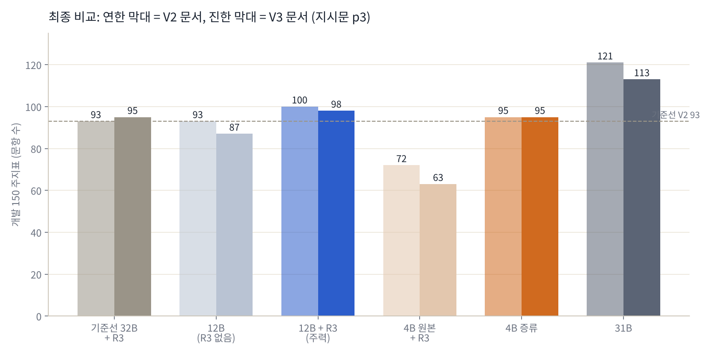
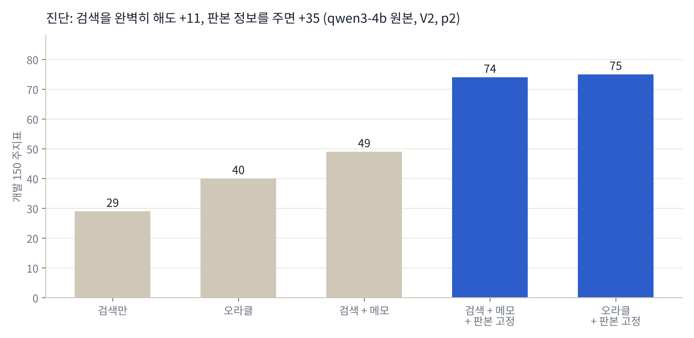
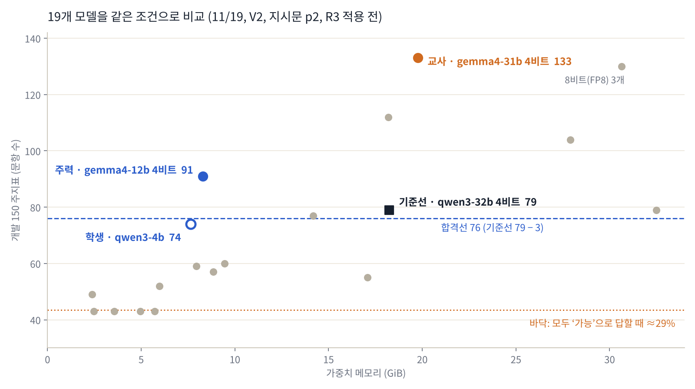
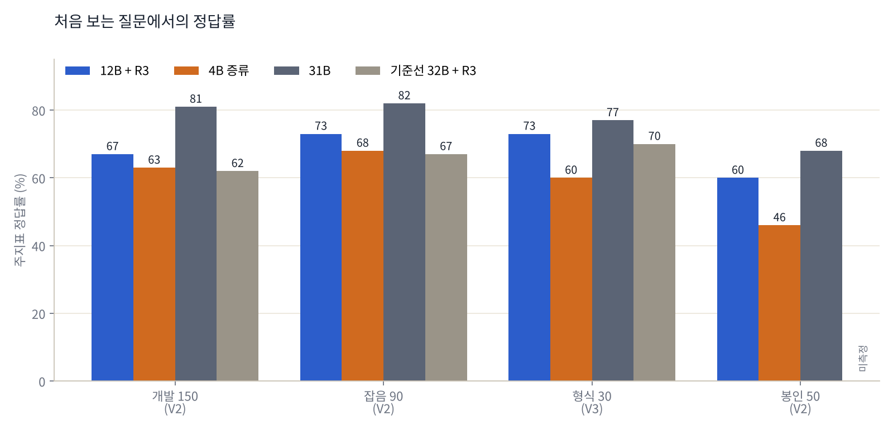

# 허RAG해줘 · DLthon2 — 모델은 줄이고, 판단은 지킨다

신혼생활 공동생활 규약집(V2 · V3)을 근거로 질문에 답하는 RAG 상담 서비스에서, **모델을 줄여도 여러 조항과 표를 근거로 올바르게 판단할 수 있는지**, 그리고 **모델은 그대로 두고 규약만 개정하면 답이 새 근거를 따라가는지** 실험했습니다.

> 답이 하나로 정해지는 일(판본 결정 · 후처리)은 코드가, 조항 해석과 판정은 모델이 나눠 맡게 했더니
> **12B 4비트 + 후처리 R3**가 32B 기준선보다 정확하면서 가중치는 45%, 응답은 2.5배 빨랐습니다.
> GPU가 더 작은 환경을 위해 **4B를 31B의 답으로 증류**해 개발 세트에서 기준선 수준(72 → 95)까지 끌어올렸습니다.

| | |
| --- | --- |
| 팀 | 권해나(A · 문서 · 검색 · 판본 규칙) · 지승환(B · 모델 · 서빙 · 실험) · 이승화(C · 팀장, 평가 · 기록 · 발표) |
| 환경 | RunPod A40 48GB 1장 · vLLM 0.34.0 · torch 2.14 · transformers 5.22 |
| 발표 자료 | [docs/발표자료.pdf](docs/발표자료.pdf) |
| 실험 기록 | [docs/실험기록.md](docs/실험기록.md) · 설계 [docs/설계.md](docs/설계.md) · 평가 규격 [docs/평가규격.md](docs/평가규격.md) |

## 목차

1. [결과](#결과)
2. [설계](#설계)
3. [모델을 고른 과정](#모델을-고른-과정)
4. [처음 보는 질문과 한계](#처음-보는-질문과-한계)
5. [저장소 구성](#저장소-구성)
6. [재현 방법](#재현-방법)
7. [모델 식별자와 설정](#모델-식별자와-설정)
8. [규약집 인덱싱 방법](#규약집-인덱싱-방법)

## 결과

개발 150문항 기준, 판정 상태와 적용 판본이 **모두** 맞은 문항 수입니다.

| 구성 | V2 / V3 | 근거 인용 V2 / V3 | 파일 · 가중치 메모리 | 응답 중앙값 / p95 | 역할 |
| --- | --- | --- | --- | --- | --- |
| 기준선 qwen3-32b 4비트(AWQ) + R3 | 93 / 95 | 82% / 80% | 19.3 GB · 18.2 GiB | 67초 / 95초 | 기준 |
| **gemma4-12b 4비트(QAT) + R3** | **100 / 98** | 80% / 77% | **10.3 GB · 8.3 GiB** | **26초 / 39초** | 주력 구성 |
| **qwen3-4b + LoRA 증류** (증류 전 72 / 63) | **95 / 95** | 81% / 77% | 8.1 GB · 7.6 GiB | **16초 / 24초** | 극한 경량화 |
| gemma4-31b 4비트(QAT) | 121 / 113 | 85% / 88% | 23.3 GB · 19.8 GiB | 58초 / 94초 | 참고 · 자원이 충분할 때 |

응답 시간은 동시 8요청 중 측정(대기 포함). 최대 GPU 메모리는 vLLM이 모든 모델에 GPU의 90%를 미리 잡아 같으므로 가중치 메모리로 비교했습니다.



## 설계

```
질문 → [코드] 검색(bge-m3) + 판정 메모 → [코드] 판본 결정(개정 항목 + 기준일 → V1 · V2 · V3)
     → [모델] 판정 JSON(상태 · 근거 · 답 · 다음 행동) → [코드] 후처리 R3
```

- 날짜로 판본을 정하는 일처럼 **답이 하나로 정해지는데 틀리면 판정이 뒤집히는 일은 코드**가, 조항 해석 · 판정 · 근거 선택은 모델이 맡습니다.
- **R3**: 상태가 '추가 확인'이고 빠진 정보가 합의 여부뿐이며 아직 하지 않은 일이면 → '사전 합의 필요'. 기준선을 포함한 **모든 모델에 똑같이** 적용해 비교했습니다.
- 판정 자체를 규칙으로 내리는 것은 일부러 보류했습니다. 코드가 판정하면 모델 비교가 의미를 잃고 개발 문항에 과적합되기 때문입니다. 자세한 내용은 [docs/설계.md](docs/설계.md).



작은 모델은 질문 속 금액(24/24)과 합의 여부(52/52)를 맞게 뽑고도 **상태와 판본을 고르는 단계**에서 틀렸습니다. 그래서 검색보다 고르는 단계를 코드로 보완했습니다.

## 모델을 고른 과정

기준 · 교사 · 학생 모델을 미리 정하지 않고, **19개 모델을 같은 검색 · 지시문 · 생성 설정으로** 모두 돌려 골랐습니다.



- 합격선(기준선 − 3문항)을 넘은 7개 중 가장 가벼운 **gemma4-12b**를 주력으로
- 1위 **gemma4-31b**(133)를 교사로. 12가지 문항 유형 모두 77% 이상이라 학생이 틀린 버릇을 배울 위험이 적음
- 합격선에 가장 가까운 소형 **qwen3-4b**(74)를 학생으로. 16비트 원본이라 바로 LoRA 학습 가능
- 같은 모델이면 4비트가 8비트와 같거나 나았고, A40에는 FP8 연산이 없어 8비트가 더 느려 **기준선을 32B 4비트로** 변경
- gemma4-e4b는 합격했지만 실제 가중치(14.2 GiB)가 12B보다 커서 제외

전체 표는 [docs/실험기록.md](docs/실험기록.md)의 2절에 있습니다.

## 처음 보는 질문과 한계



| 실패 | 내용 | 다음 과제 |
| --- | --- | --- |
| 판본 규칙 과적합 | 개발 150에서 100% → 봉인 50에서 82% / 74%. 처음 보는 표현 6건, 날짜 해석 6건 | 개정 항목 판별을 임베딩 · LLM으로, 날짜 해석 코드 수정 |
| 판본 고정이 31B에겐 천장 | 봉인에서 규칙을 끄자 31B 26 → 33, 12B 28 → 23 (V3) | 31B에는 판본을 힌트로만 주기 |
| 계산-결론 모순 | 31B가 월 원리금을 맞게 계산하고도 표의 예시 금액을 상한으로 오해 | 금액 비교를 코드로 |
| 증류 일반화 부족 | 4B 증류 개발 63% → 봉인 46% | 잡음 · 형식 변형을 섞어 재증류, 4비트 양자화 |

**공정성**: 공개 100 · 봉인 50 실행 전에 최종 조합을 노션에 기록하고, 결과를 본 뒤 모델 · 규칙 · 정답을 고치지 않았습니다. 첫 봉인 실행 뒤 31B 후보 누락을 발견해, "개발 세트 점수로만 고른다"를 먼저 기록하고 추가했습니다. 공개 100은 판본 규칙을 다듬을 때 일부를 봐서 오염이 있습니다.

## 저장소 구성

| 폴더 | 내용 | 담당 |
| --- | --- | --- |
| [`regulations/`](regulations) | 배포된 규약집 V2(1일차) · V3(4일차) · 개정 안내 | 운영진 배포 |
| [`retrieval/`](retrieval) | PDF 추출, 쪽 단위 청크 + 꼬리표, 표 행 보조 청크, bge-m3 색인 · 검색, 판본 규칙, 검색 평가 | A |
| [`serving/`](serving) | vLLM 일괄 실행기 `run_all.py`, 지시문 p3, 출력 스키마, 채점, 교사 답 생성 · LoRA 학습 · 병합 스크립트 | B |
| [`distill/`](distill) | 증류 학습 질문 생성, 평가 세트와의 겹침 검사, 채점을 통과한 교사 답 목록 | C |
| [`eval/`](eval) | 공개 100 · 봉인 50 실행과 채점, 판본 규칙을 끈 분석 실행 | C |
| [`data/`](data) | 개발 150 · 잡음 90 · 형식 30 · 단문 15 · V3 쌍 16 문항과 정답(V2 · V3), 검수표, 증류 학습 질문, V2 색인 산출물, 검색 결과 | A · C |
| [`results/`](results) | 채점 요약표, 모델 출력 원본(개발 · 잡음 · 형식 · 교사 답), 서버 로그 | B · C |
| [`docs/`](docs) | 발표 자료, 실험 기록, 설계, 평가 규격, 그림 | C |

## 재현 방법

```bash
# 0) 모델 받기 (gemma는 Hugging Face 라이선스 동의 필요, 토큰은 터미널에서만 export)
export HF_TOKEN=...
python -c "from huggingface_hub import snapshot_download as s; s('google/gemma-4-12B-it-qat-w4a16-ct', local_dir='/workspace/models/gemma4-12b-qat')"

# 1) 평가 — serving/에서 실행. V2 · V3 개발 150 · 잡음 90 · 형식 30
cd serving
bash 평가_실행.sh gemma4-12b-qat google/gemma-4-12B-it-qat-w4a16-ct 모두
python 채점.py                                   # → results/평가_요약.md

# 2) 증류 — 교사 답 → 거르기 → 학습 → 병합 → 평가
bash teach.sh retrieval_train860_V2_g33.jsonl retrieval_train860_V3_g33.jsonl
python make_sft.py results/results_TEACHp3_860_V3.jsonl gemma4-31b-qat data/문항_train860_V3.jsonl \
  data/검색결과_train860_V3.jsonl data/판본_train860_V3.jsonl p3_V3.txt data/sft_V3.jsonl ../distill/C가_고른_문항_V3.txt
python train_lora.py data/sft_V3.jsonl /workspace/models/qwen3-4b-instruct-2507 /workspace/lora_qwen3-4b
python merge_lora.py /workspace/models/qwen3-4b-instruct-2507 /workspace/lora_qwen3-4b /workspace/models/qwen3-4b-lora
bash 평가_실행.sh qwen3-4b-lora - 모두
```

- 검색 결과 파일은 `retrieval/notebooks/role_A_colab.ipynb`로 만들어 `serving/data/`에 넣습니다. V3 개발 세트용 검색 결과는 `data/retrieval_V3/`에 압축해 두었습니다.
- vLLM은 직접 띄우지 않습니다. `run_all.py`가 모델마다 서버를 띄우고 끕니다. 두 개를 동시에 띄우지 않습니다.
- 세부 실행 방법은 승환 님 인수인계 문서 [serving/읽어주세요_인수인계_B.md](serving/읽어주세요_인수인계_B.md)를 참고하세요.

## 모델 식별자와 설정

| 용도 | 식별자 |
| --- | --- |
| 기준선 | `Qwen/Qwen3-32B-AWQ` |
| 주력 | `google/gemma-4-12B-it-qat-w4a16-ct` + 후처리 R3 |
| 교사 / 참고 | `google/gemma-4-31B-it-qat-w4a16-ct` |
| 학생 | `Qwen/Qwen3-4B-Instruct-2507` + LoRA(랭크 16 · alpha 32 · dropout 0.05 · 모든 선형층 · 학습률 1e-4 · 2에폭 · 최대 16,384토큰, 교사 답 746문항, A40 2시간 45분) |

생성 설정: temperature 0 · seed 0 · 추론 모드 끔 · JSON 스키마 강제 · 최대 출력 1,536토큰(형식 · 공개 · 봉인 2,048) · 최대 문맥 32,768 · GPU 메모리 90% · 동시 8요청.

## 규약집 인덱싱 방법

1. PDF에서 본문과 표를 따로 추출하고 쪽 번호를 보존 (반복 머리말 · 꼬리말 제거)
2. 쪽 단위 청크 + 꼬리표(문서 판본 · 쪽 · 조항 · 표 · 개정 항목 여부)
3. 표의 각 행은 열 이름을 붙인 문장으로 바꿔 보조 청크로 분리
4. bge-m3 임베딩으로 색인, 재순위 후 청크 안의 '제N조 · 표 NN'을 한 단계 따라가 함께 가져옴
5. V2 합본과 V3 합본은 색인을 따로 만들고, 개정 비교 때 색인만 바꿔 끼움

V2 색인 산출물(페이지 · 청크 · 표 행 · 조항-쪽 대응)은 [`data/index_V2/`](data/index_V2)에 있습니다.

## 넣지 않은 것

- 운영진 평가 키트(공개 100 · 최종 평가)의 질문과 정답, 팀장이 보관한 봉인 50 문항과 정답: 평가용 비공개 자료라 제외했습니다. 점수는 [results/](results)와 [docs/실험기록.md](docs/실험기록.md)에 있습니다.
- 증류 학습용 검색 결과(파일당 약 40MB)와 LoRA 체크포인트: 위 재현 방법으로 다시 만들 수 있습니다.
